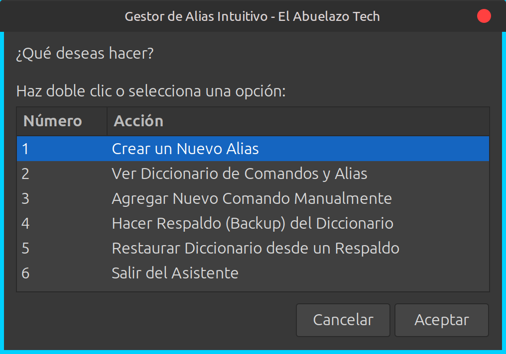

# ⚡ Galias — Gestor Visual de Alias para Linux Mint

Herramienta gráfica ligera desarrollada por **El Abuelazo Tech** para crear, administrar y activar alias de comandos de terminal de forma sencilla en Linux Mint, facilitando el salto directo a la terminal lista para usarlos.

---

## ✨ Características principales

* **Interfaz gráfica intuitiva:** Añade tus atajos y alias favoritos sin necesidad de editar manualmente archivos complejos como `~/.bashrc`.
* **Integración con la terminal:** Al guardar tu alias, la aplicación te dirige automáticamente a la terminal lista para probarlo al instante.
* **Diseño optimizado:** Ligero, rápido y pensado especialmente para quienes se inician en Linux y para usuarios experimentados que buscan optimizar su flujo.
* **Instalación nativa:** Se integra perfectamente en el menú de aplicaciones de Linux Mint mediante paquete `.deb`.

---

## 🚀 Instalación sencilla (Recomendada)

1. Haz clic sobre el archivo **`galias_1.0-1_amd64.deb`** en la lista superior de este repositorio.
2. Pulsa el botón **Download raw file** (icono de descarga) para guardarlo en tu equipo.
3. Haz **doble clic** sobre el archivo descargado en tu gestor de archivos.
4. Pulsa en **Instalar el paquete** e introduce tu contraseña.
5. ¡Listo! Ya puedes abrir **Galias** desde el menú de inicio de Linux Mint.

---

## 💻 Código Abierto y Transparencia

Para cumplir con la filosofía del software libre, el código fuente original del script (`galias.sh`) se encuentra disponible públicamente en este repositorio para su auditoría y consulta.

---

## ☕ Apoya este proyecto

Si esta utilidad te ahorra tiempo y te resulta práctica en tu día a día con Linux, puedes invitarme a un café para seguir creando herramientas gratuitas y contenido educativo:

👉 [**Apoyar a El Abuelazo Tech en Ko-fi**](https://ko-fi.com/abuelazotech)
